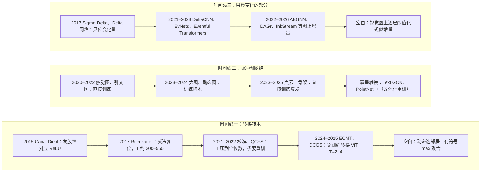

# 2 时间线：转换技术

> Notion 页面：https://www.notion.so/41b0e3342e6f81d9ad63c20ebe0b51b5 （导出自 Notion 实时内容，最后编辑时间 `2026-11-21T03:01:55.332Z`）

<callout icon="📌" color="blue_bg">
<b>一句话结论</b>：十年里，转换技术把所需的时间步从几百降到个位数，把适用范围从小型卷积网络（用小窗口在整张图片上滑动扫描的传统看图模型）扩到 Transformer（让所有图块互相打分交换信息的大模型）；但“最大值”这类操作一直是难点，视觉图网络还没进入这条线。
</callout>

先看全景：三条时间线各自的里程碑（第 2、3、5 页分别展开）。

<i>图注：这张图想让你看到的是三条线各自走到了哪一步，以及每条线末尾还空着什么。方框里的年份和结论都来自文献库条目。</i>

## 一步步解决了什么

<b>打个比方</b>：像学一门外语，最早要说很久对方才听懂（时间步很多），后来越说越简洁；但一开始只会说简单句（简单网络），后来才会说复杂句（Transformer）。

<b>准确地说</b>：每一代方法都在三件事之间取舍——时间步多少、要不要重训原网络、能处理哪些运算。比方不成立的地方：学外语是越学越好，而转换方法常常是“步数少了，就得重训原网络”，不是单纯进步。

| 年份 | 代表工作 | 解决了什么 | 留下了什么 |
| --- | --- | --- | --- |
| 2015 | Cao 等 <mention url="https://app.notion.com/p/41b0e3342e6f817bb31fc077803fd854">Spiking Deep CNN 奠基（2015）</mention> \[[原文](https://doi.org/10.1007/s11263-014-0788-3)\] \[[中文](https://app.notion.com/p/41c0e3342e6f81be8e9fd80c31220dc4)\]、Diehl 等 <mention url="https://app.notion.com/p/41b0e3342e6f814d9c5cd7dbcc3e1841">Weight & Threshold Balancing（2015）</mention> \[[原文](https://doi.org/10.1109/IJCNN.2015.7280696)\] \[[中文](https://app.notion.com/p/41c0e3342e6f81a3b666db35f4856d1c)\] \[[代码](https://github.com/dannyneil/spiking_relu_conversion)\] | 发现发放率可以对应 ReLU 的输出，并按层归一化权重 | 原网络不能有偏置（神经元额外加上的底数）、不能用最大池化（在小区域里只留最大值）；需要几百个时间步 |
| 2017 | Rueckauer 等 <mention url="https://app.notion.com/p/41b0e3342e6f81a3b2f0dca38f8f241d">SNN Toolbox（2017）</mention> \[[原文](https://arxiv.org/abs/1612.04052)\] \[[中文](https://app.notion.com/p/41c0e3342e6f8178a7dcc29d4be95557)\] \[[代码](https://github.com/NeuromorphicProcessorProject/snn_toolbox)\] | 减法复位、支持批归一化（把每层输出拉回稳定范围）和最大池化，能直接转换标准网络 | 需要 300–550 个时间步 |
| 2019–2020 | Spike-Norm <mention url="https://app.notion.com/p/41b0e3342e6f815d96d5cd4423a54b93">Spike-Norm（2019）</mention> \[[原文](https://arxiv.org/abs/1802.02627)\] \[[中文](https://app.notion.com/p/41c0e3342e6f81329ee8c1e0b80641b3)\]、RMP-SNN <mention url="https://app.notion.com/p/41b0e3342e6f815c9d73d7b48bccc386">RMP-SNN（2020）</mention> \[[原文](https://arxiv.org/abs/2003.01811)\] \[[中文](https://app.notion.com/p/41c0e3342e6f81bfa3c7fa5a632233ac)\]、Spiking-YOLO <mention url="https://app.notion.com/p/41b0e3342e6f81498d48f9ad639042f8">Spiking-YOLO（2020）</mention> \[[原文](https://arxiv.org/abs/1903.06530)\] \[[中文](https://app.notion.com/p/41c0e3342e6f811fa9d7f99210f5df10)\] | 推到 ImageNet 深层网络和目标检测（在图里框出物体） | ImageNet 上要 2500 步（Spike-Norm）或 512–4096 步（RMP-SNN） |
| 2021–2023 | 校准 <mention url="https://app.notion.com/p/41b0e3342e6f81449ff6c194ab8d964a">SNNC-AP / SNN Calibration（2021）</mention> \[[原文](https://arxiv.org/abs/2106.06984)\] \[[中文](https://app.notion.com/p/41c0e3342e6f8147a4e0d2bb781d13cd)\]、QCFS <mention url="https://app.notion.com/p/41b0e3342e6f810591f7f303160e35ff">QCFS（2022）</mention> \[[原文](https://arxiv.org/abs/2303.04347)\] \[[中文](https://app.notion.com/p/41c0e3342e6f81c494d8f8bb510b7924)\] \[[代码](https://github.com/putshua/SNN_conversion_QCFS)\]、偏移校准 <mention url="https://app.notion.com/p/41b0e3342e6f81aa9cccf5ca27331479">COS（2023）</mention> \[[原文](https://arxiv.org/abs/2302.10685)\] \[[中文](https://app.notion.com/p/41c0e3342e6f8177988ed774243be8cb)\] \[[代码](https://github.com/hzc1208/ANN2SNN_COS)\] | 分析误差来源，把时间步压到个位数 | 多数要先改造并重训原网络，最大池化要换成平均池化（留平均值） |
| 2024 | STA <mention url="https://app.notion.com/p/41b0e3342e6f814f9595dcc2bb722d1c">STA（2024）</mention> \[[原文](https://openreview.net/forum?id=135eKq323G)\] \[[中文](https://app.notion.com/p/41c0e3342e6f8161998bcb3a2b8280ff)\] \[[代码](https://github.com/ViviaHu/STA)\]、SpikeZIP-TF <mention url="https://app.notion.com/p/41b0e3342e6f81e2a77bf2c3063d849f">SpikeZIP-TF（2024）</mention> \[[原文](https://arxiv.org/abs/2406.03470)\] \[[中文](https://app.notion.com/p/41c0e3342e6f8161867ae5e8e17f9ce9)\] \[[代码](https://github.com/Intelligent-Computing-Research-Group/SpikeZIP-TF)\]、ECMT <mention url="https://app.notion.com/p/41b0e3342e6f81fb8512ef5304537699">ECMT（2024）</mention> \[[原文](https://arxiv.org/abs/2502.21193)\] \[[中文](https://app.notion.com/p/41c0e3342e6f8129bcfcf6ef8a0ce95a)\] \[[代码](https://github.com/h-z-h-cell/Transformer-to-SNN-ECMT)\] | 转换 Transformer：注意力（按相关度给别的块打分）、归一化、GELU（平滑版 ReLU） | STA 免训练但要 64–256 步；SpikeZIP-TF 要先重训；ECMT 的非线性部分仍用浮点计算（普通电脑带小数点的精确数运算） |
| 2025 | DCGS <mention url="https://app.notion.com/p/41b0e3342e6f81d8b1d1ccbe05acdde2">DCGS（2025）</mention> \[[原文](https://arxiv.org/abs/2503.00301)\] \[[中文](https://app.notion.com/p/41c0e3342e6f81aaa37dce2e24d59585)\] \[[代码](https://github.com/h-z-h-cell/ANN-to-SNN-DCGS)\]、Bu 等 <mention url="https://app.notion.com/p/41b0e3342e6f8189b3dcdf43ac9f4e6e">Inference-Scale Conversion（2025）</mention> \[[原文](https://arxiv.org/abs/2409.03368)\] \[[中文](https://app.notion.com/p/41c0e3342e6f81858a3fc2a999ed12b0)\] \[[代码](https://github.com/putshua/Inference-scale-ANN-SNN)\] | 免训练、2–4 步转换视觉版 Transformer（ViT）；最大池化挪到脉冲神经元之前算 | DCGS 代码遇到重叠的最大池化就退回浮点；都没有涉及图 |
| 2026 | MBE 神经元 <mention url="https://app.notion.com/p/41b0e3342e6f81e5b9eaf84dbb01a5cf">MBE 脉冲浮点转换（2026）</mention> \[[原文](https://arxiv.org/abs/2508.07710)\] \[[中文](https://app.notion.com/p/41c0e3342e6f81cd8a8ac562ce9ad31e)\] | 免训练、全脉冲地逼近各种非线性 | 16 步时 85.31%，10 步时跌到 21.99% |

<callout icon="✅" color="green_bg">
<b>事实</b>：DCGS 在 ImageNet 上，ViT-Small 用 4 个时间步达到 81.11%（原网络 81.38%）；在 COCO 目标检测数据集上用 4 步达到 44.1% mAP（检测综合准确率，原网络 45.7%）<mention url="https://app.notion.com/p/41b0e3342e6f81d8b1d1ccbe05acdde2">DCGS（2025）</mention> \[[原文](https://arxiv.org/abs/2503.00301)\] \[[中文](https://app.notion.com/p/41c0e3342e6f81aaa37dce2e24d59585)\] \[[代码](https://github.com/h-z-h-cell/ANN-to-SNN-DCGS)\]。它的多阈值神经元有正负对称的 2n 级阈值，代码默认 n = 8，即 16 级（见 [questions.md Q5](https://github.com/Casey-sketch-cyber/gnn2gsnn/blob/main/literature/questions.md)）。
</callout>

👉 <b>想看推导</b>：<mention url="https://app.notion.com/p/41c0e3342e6f819b94c7f590cf469e44">第 7 章 核心：为什么发放率约等于 ReLU</mention>（裂项求和与 QCFS 定理 1–2）。

## 时间步多少的影响

<b>打个比方</b>：用“举手次数”报一个分数——给你 4 次机会只能报到四分之一精度，给你 32 次就细得多，但举手也累得多。

<b>准确地说</b>：一个数在脉冲网络里靠“T 步里发几次”表示，T 越大越准，但发的脉冲越多，计算和能耗也越多。比方不成立的地方：真实网络里误差会一层层累积，而且新方法（如分级脉冲）一次能带一个数值，不完全靠次数。

<embed source="notion-file-block://41b0e334-2e6f-81ba-bde8-c1d4076b9bf9/5c54a200-c7c3-43fc-beb8-f573e94e317d?space_id=1b7e5bf6-cfb2-4b86-9177-df3a2bb9b36f&name=f5-timesteps.html">
交互动画（可暂停）
</embed>

<i>上面是可以暂停、拖动的交互版；下面是同一内容的静态图，导出成文件后也能看。</i>

<image source="notion-file-block://41b0e334-2e6f-81d3-9c9e-d12831575913/955fbccc-e5ba-4ca8-9504-beff024334ba?space_id=1b7e5bf6-cfb2-4b86-9177-df3a2bb9b36f&name=f5-timesteps.svg">
这张图想让你看到的是：时间步越多，还原出的数越准，但发的脉冲也越多、越费电。示意，非真实数据。
</image>

👉 <b>想看推导</b>：<mention url="https://app.notion.com/p/41d0e3342e6f81a88e0cee5577f5e2c3">第 8 章 带符号、多阈值和差分编码</mention>（DCGS 全部方法公式逐字符核对，为何能压到 $T=2\sim 4$）。

## 最大值（max）这类操作为什么一直难

最大池化在普通卷积网络里很常见，视觉图网络的“取邻居最大值”也是同一类操作。

- 早期办法是绕开：把最大池化换成平均池化再重训原网络，QCFS、校准方法都这样做 <mention url="https://app.notion.com/p/41b0e3342e6f810591f7f303160e35ff">QCFS（2022）</mention> \[[原文](https://arxiv.org/abs/2303.04347)\] \[[中文](https://app.notion.com/p/41c0e3342e6f81c494d8f8bb510b7924)\] \[[代码](https://github.com/putshua/SNN_conversion_QCFS)\] <mention url="https://app.notion.com/p/41b0e3342e6f81449ff6c194ab8d964a">SNNC-AP / SNN Calibration（2021）</mention> \[[原文](https://arxiv.org/abs/2106.06984)\] \[[中文](https://app.notion.com/p/41c0e3342e6f8147a4e0d2bb781d13cd)\]。
- 纯脉冲电路的办法：逐步取最大会系统性高估，侧抑制池化（先发脉冲的神经元抑制周围，减少重复计数）可以纠正，但要求输入非负、需要 16–32 步 <mention url="https://app.notion.com/p/41b0e3342e6f81ee8cf8c39f24740761">Burst + LIPooling（2022）</mention> \[[原文](https://arxiv.org/abs/2204.13271)\] \[[中文](https://app.notion.com/p/41c0e3342e6f817a8f53f3b7a7c0da66)\] \[[代码](https://github.com/BrainCog-X/Brain-Cog)\]；Loihi 类脑芯片上的电路需要 50–120 步 <mention url="https://app.notion.com/p/41b0e3342e6f81659b92e95317f25094">Spiking MaxPooling 电路（2022）</mention> \[[原文](https://arxiv.org/abs/2205.07076)\] \[[中文](https://app.notion.com/p/41c0e3342e6f81e2bb18dc80085f6d94)\]。
- Bu 等的办法：利用“先取最大再 ReLU 等于先 ReLU 再取最大”（最大值大于 0 时成立），把最大池化挪到脉冲神经元之前、对累积的连续值直接比较 <mention url="https://app.notion.com/p/41b0e3342e6f8189b3dcdf43ac9f4e6e">Inference-Scale Conversion（2025）</mention> \[[原文](https://arxiv.org/abs/2409.03368)\] \[[中文](https://app.notion.com/p/41c0e3342e6f81858a3fc2a999ed12b0)\] \[[代码](https://github.com/putshua/Inference-scale-ANN-SNN)\]。

<callout icon="💭" color="yellow_bg">
<b>判断（来自文献核查）</b>：这几种办法都不能原样用在 ViG 上，因为 ViG 取最大值的对象是“邻居减自己”的差值，可正可负，后面也没有 ReLU（见 [audit 文件](https://github.com/Casey-sketch-cyber/gnn2gsnn/blob/main/literature/audit-of-claude-v1.md)难点树第 5 行）。
</callout>

<callout icon="❓" color="gray_bg">
<b>未知</b>：在视觉图网络上，用 2–4 个时间步时最大值聚合会产生多大误差，没有实验数据。
</callout>

👉 <b>想看推导</b>：<mention url="https://app.notion.com/p/41d0e3342e6f815698f9db048cdba5d9">第 9 章 非线性运算为什么难转换</mention>（<code>max</code> 错峰反例、Bu 等定理 2 条件及为何套不到 ViG）。

<b>三句话小结</b>

1. 时间步从几百降到个位数，靠的是误差分析、校准和多阈值神经元。
2. 很多低步数方法要先重训原网络；真正免训练又能到 2–4 步的代表是 DCGS。
3. 最大值操作一直被绕开或特殊处理，现有办法都不能直接搬到 ViG 上。

<b>读完应该能回答的两个问题</b>

- 为什么 QCFS 这类方法虽然步数少，但不符合本项目“免训练”的路线？
- Bu 等处理最大池化的办法，为什么不能直接用在 ViG 上？
