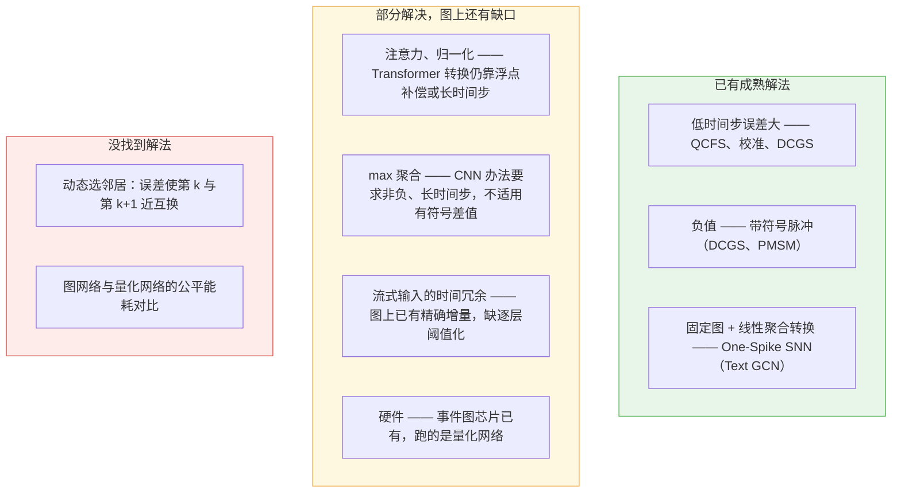

# 7 难点地图

> Notion 页面：https://www.notion.so/41b0e3342e6f81c68e0ac192040b01d3 （导出自 Notion 实时内容，最后编辑时间 `2026-11-21T03:02:14.155Z`）

<callout icon="📌" color="blue_bg">
<b>一句话结论</b>：九个难点里，三个已有成熟解法，四个部分解决、图上还有缺口，两个没找到解法——“动态选邻居会不会因误差翻转”和“图网络与量化网络的公平能耗对比”。
</callout>

<i>图注：这张图想让你看到的是哪些难点已经有人解决（绿）、哪些部分解决（黄）、哪些还空着（红）。分组依据是 </i>[<i>audit 文件</i>](https://github.com/Casey-sketch-cyber/gnn2gsnn/blob/main/literature/audit-of-claude-v1.md)<i>的难点树核查结果。</i>

## 逐个说明

| 难点 | 谁解决了 | 在图上还缺什么 |
| --- | --- | --- |
| 时间步少时误差大 | QCFS <mention url="https://app.notion.com/p/41b0e3342e6f810591f7f303160e35ff">QCFS（2022）</mention> \[[原文](https://arxiv.org/abs/2303.04347)\] \[[中文](https://app.notion.com/p/41c0e3342e6f81c494d8f8bb510b7924)\] \[[代码](https://github.com/putshua/SNN_conversion_QCFS)\]、校准 <mention url="https://app.notion.com/p/41b0e3342e6f81449ff6c194ab8d964a">SNNC-AP / SNN Calibration（2021）</mention> \[[原文](https://arxiv.org/abs/2106.06984)\] \[[中文](https://app.notion.com/p/41c0e3342e6f8147a4e0d2bb781d13cd)\]、DCGS <mention url="https://app.notion.com/p/41b0e3342e6f81d8b1d1ccbe05acdde2">DCGS（2025）</mention> \[[原文](https://arxiv.org/abs/2503.00301)\] \[[中文](https://app.notion.com/p/41c0e3342e6f81aaa37dce2e24d59585)\] \[[代码](https://github.com/h-z-h-cell/ANN-to-SNN-DCGS)\] | QCFS 要重训；DCGS 遇到重叠的最大池化退回浮点 |
| 负值 | DCGS 的正负阈值 <mention url="https://app.notion.com/p/41b0e3342e6f81d8b1d1ccbe05acdde2">DCGS（2025）</mention> \[[原文](https://arxiv.org/abs/2503.00301)\] \[[中文](https://app.notion.com/p/41c0e3342e6f81aaa37dce2e24d59585)\] \[[代码](https://github.com/h-z-h-cell/ANN-to-SNN-DCGS)\]、PMSM 的正负脉冲 <mention url="https://app.notion.com/p/41b0e3342e6f8179813af26151210c36">PMSM（2025）</mention> \[[原文](https://arxiv.org/abs/2508.14520)\] \[[中文](https://app.notion.com/p/41c0e3342e6f81a8a8a6fdd9784e054b)\] | 和“取最大值”叠加时要一起处理 |
| 固定图 + 线性聚合 | One-Spike SNN（文本图）<mention url="https://app.notion.com/p/41b0e3342e6f8142af44e1d41fa091ff">One-Spike SNN（2025）</mention> \[[原文](https://arxiv.org/abs/2403.08786)\] \[[中文](https://app.notion.com/p/41c0e3342e6f81efadabda09415c2abe)\] | 视觉固定图上未测 |
| 注意力、归一化 | SpikeZIP-TF <mention url="https://app.notion.com/p/41b0e3342e6f81e2a77bf2c3063d849f">SpikeZIP-TF（2024）</mention> \[[原文](https://arxiv.org/abs/2406.03470)\] \[[中文](https://app.notion.com/p/41c0e3342e6f8161867ae5e8e17f9ce9)\] \[[代码](https://github.com/Intelligent-Computing-Research-Group/SpikeZIP-TF)\]、STA <mention url="https://app.notion.com/p/41b0e3342e6f814f9595dcc2bb722d1c">STA（2024）</mention> \[[原文](https://openreview.net/forum?id=135eKq323G)\] \[[中文](https://app.notion.com/p/41c0e3342e6f8161998bcb3a2b8280ff)\] \[[代码](https://github.com/ViviaHu/STA)\]、ECMT <mention url="https://app.notion.com/p/41b0e3342e6f81fb8512ef5304537699">ECMT（2024）</mention> \[[原文](https://arxiv.org/abs/2502.21193)\] \[[中文](https://app.notion.com/p/41c0e3342e6f8129bcfcf6ef8a0ce95a)\] \[[代码](https://github.com/h-z-h-cell/Transformer-to-SNN-ECMT)\] | 仍靠浮点补偿或很长的时间步；图上的门控和可变邻域注意力没有方案 |
| 取最大值聚合 | 侧抑制池化 <mention url="https://app.notion.com/p/41b0e3342e6f81ee8cf8c39f24740761">Burst + LIPooling（2022）</mention> \[[原文](https://arxiv.org/abs/2204.13271)\] \[[中文](https://app.notion.com/p/41c0e3342e6f817a8f53f3b7a7c0da66)\] \[[代码](https://github.com/BrainCog-X/Brain-Cog)\]、Bu 等 <mention url="https://app.notion.com/p/41b0e3342e6f8189b3dcdf43ac9f4e6e">Inference-Scale Conversion（2025）</mention> \[[原文](https://arxiv.org/abs/2409.03368)\] \[[中文](https://app.notion.com/p/41c0e3342e6f81858a3fc2a999ed12b0)\] \[[代码](https://github.com/putshua/Inference-scale-ANN-SNN)\] | 都要求非负或后接 ReLU；ViG 取的是有正有负的差值 |
| 流式输入的重复计算 | DeltaCNN <mention url="https://app.notion.com/p/41b0e3342e6f818886f2fd847900b43e">DeltaCNN（2022）</mention> \[[原文](https://arxiv.org/abs/2203.03996)\] \[[中文](https://app.notion.com/p/41c0e3342e6f81708df6e3bb99ecf70f)\] \[[代码](https://github.com/facebookresearch/DeltaCNN)\]、AEGNN <mention url="https://app.notion.com/p/41b0e3342e6f81d58665c55f7cb453c6">AEGNN（2022）</mention> \[[原文](https://arxiv.org/abs/2203.17149)\] \[[中文](https://app.notion.com/p/41c0e3342e6f8191a64dd5931787449f)\] \[[代码](https://github.com/uzh-rpg/aegnn)\]、InkStream <mention url="https://app.notion.com/p/41b0e3342e6f8150b1b1f1356365a7bf">InkStream（2025）</mention> \[[原文](https://arxiv.org/abs/2309.11071)\] \[[中文](https://app.notion.com/p/41c0e3342e6f81e98129eaca94521868)\] \[[代码](https://github.com/WuDan0399/InkStream)\] | 图上已有精确增量，缺逐层阈值截断 |
| 硬件 | EvGNN <mention url="https://app.notion.com/p/41b0e3342e6f8152bc9afe36594e3e25">EvGNN（2025）</mention> \[[原文](https://arxiv.org/abs/2404.19489)\] \[[中文](https://app.notion.com/p/41c0e3342e6f81588513d39a27c17a85)\] \[[代码](https://github.com/cogsys-tudelft/evgnn)\]、ETHEREAL <mention url="https://app.notion.com/p/41b0e3342e6f81b78866fd3008d1ab55">ETHEREAL（2026）</mention> \[[原文](https://arxiv.org/abs/2608.17787)\] \[[中文](https://app.notion.com/p/41c0e3342e6f8167aab6d7b4b8b51a3e)\] | 芯片跑的是量化网络，不是脉冲网络 |
| 动态选邻居 | 没找到 | 误差可能让第 k 近和第 k+1 近的邻居互换 |
| 公平能耗对比 | 卷积网络上有 Yan 等 <mention url="https://app.notion.com/p/41b0e3342e6f81008f8ee1e46358f201">Yan 等：QNN-SNN Twin 能耗分析（2026）</mention> \[[原文](https://arxiv.org/abs/2409.08290)\] \[[中文](https://app.notion.com/p/41c0e3342e6f8192a0fee40d238c4efe)\] | 图网络上没找到 |

👉 <b>想看推导</b>：<mention url="https://app.notion.com/p/41d0e3342e6f815698f9db048cdba5d9">第 9 章 非线性运算为什么难转换</mention>、<mention url="https://app.notion.com/p/41f0e3342e6f8135b55eda085c440a75">第 11 章 只算变化的部分</mention> 与 <mention url="https://app.notion.com/p/41f0e3342e6f81a6ac0bcac80292afa4">第 12 章 省电到底怎么算</mention>。

## 动态选邻居为什么可能出错

<b>打个比方</b>：班里按身高挑前三名，第三名和第四名只差半厘米；如果尺子有一点误差，两人的名次就可能对调。

<b>准确地说</b>：ViG、DGCNN 每层按特征距离挑最近的 k 个邻居。转换成脉冲网络后特征会带一点误差，距离也随之有误差。如果第 k 近和第 k+1 近本来就挨得很近，误差可能让两者互换，这一层聚合的对象就变了。比方不成立的地方：身高只有一个数，而特征有几十到几百个数，误差在不同方向上的影响不一样。

<embed source="notion-file-block://41b0e334-2e6f-8166-a393-f5082006c72d/f40f7e39-a8cf-4301-a5bd-354a1aab9b28?space_id=1b7e5bf6-cfb2-4b86-9177-df3a2bb9b36f&name=f6-knn-flip.html">
交互动画（可暂停）
</embed>

<i>上面是可以暂停、拖动的交互版；下面是同一内容的静态图，导出成文件后也能看。</i>

<image source="notion-file-block://41b0e334-2e6f-8127-9c2a-f1ecae95b072/7b943c06-4b0a-4a7a-8eb3-e45adc987cb7?space_id=1b7e5bf6-cfb2-4b86-9177-df3a2bb9b36f&name=f6-knn-flip.svg">
这张图想让你看到的是：第 k 近和第 k+1 近本来就挨得很近时，一点误差就能让两者互换，选出的邻居就变了。示意，非真实数据。
</image>

<callout icon="✅" color="green_bg">
<b>事实（初等推导与已有研究）</b>：如果每个点的特征误差不超过 ε，任意两点距离的变化不超过 2ε；所以只要第 k 近和第 k+1 近的距离差大于 4ε，邻居集合一定不变。近似最近邻检索（在大批向量里快速找最相近几个的算法）的研究（RaBitQ，SIGMOD 2024）发现，查询向量量化到约 4 位时召回率（真正的前 k 名被找对的比例）已接近原值，1 位时大幅下降。出处见 [questions.md 的 Q9](https://github.com/Casey-sketch-cyber/gnn2gsnn/blob/main/literature/questions.md)；这几篇理论文献在文献库里还没有单独的条目（已记入 仓库 <code>notion/gaps.md</code>）。
</callout>

<callout icon="✅" color="green_bg">
<b>事实（取最大值的误差）</b>：取最大值本身不会放大误差——输出误差不超过输入的最大误差。但如果每个候选都带零均值的随机误差，取最大值会系统性偏高；k 个候选各带均匀分布误差时，期望偏高 (k−1)/(k+1)·ε，k = 9 时约 0.8ε（出处见 [questions.md 的 Q10](https://github.com/Casey-sketch-cyber/gnn2gsnn/blob/main/literature/questions.md)）。
</callout>

<callout icon="❓" color="gray_bg">
<b>未知</b>：真实的 ViG、DGCNN 每层“第 k 近与第 k+1 近的距离差”有多大、转换后多少比例的邻居会变、精度会掉多少，都没有实验数据。这正是第 8 页“失效普查”要回答的。
</callout>

👉 <b>想看推导</b>：<mention url="https://app.notion.com/p/41d0e3342e6f81139bdec1e4296f2664">第 10 章 近似误差会不会让选邻居出错</mention>（$2\varepsilon$ 与 $4\varepsilon$ 紧界完整证明、时间步下界与模拟视觉图翻转率曲线）。

<b>三句话小结</b>

1. 低时间步、负值、固定图线性聚合已有解法；注意力、取最大值、流式、硬件部分解决。
2. 动态选邻居和图上的公平能耗对比没找到解法。
3. 邻居会不会翻转，取决于误差大小和第 k、k+1 近邻的距离差，真实模型上还没测过。

<b>读完应该能回答的两个问题</b>

- 什么情况下转换误差一定不会让邻居集合改变？
- 为什么说现有处理最大池化的办法不能直接用在 ViG 上？
