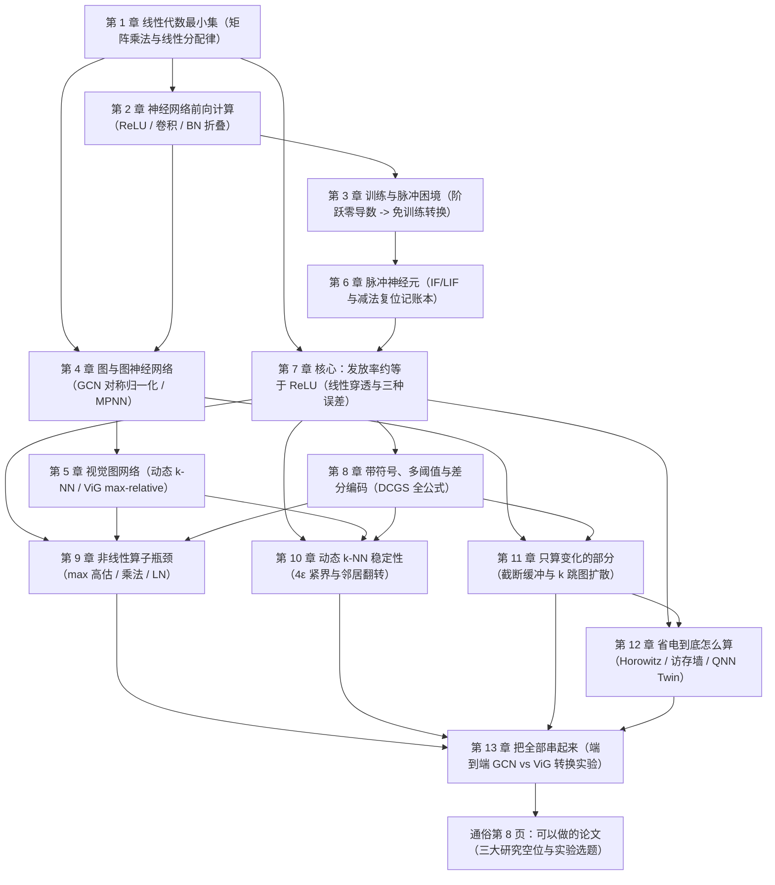

# 🗺️ 学习路线（从零推导到独立选题）

> Notion 页面：https://www.notion.so/41f0e3342e6f81d6b020dd784060f201 （导出自 Notion 实时内容，最后编辑时间 `2026-11-21T02:58:39.240Z`）

<callout icon="📌" color="blue_bg">
<b>一句话说明</b>：这张路线图告诉你“先学什么、后学什么、哪些可以跳过”，并用一张概念依赖图把第 1～13 章、通俗页（<code>0</code>～<code>11</code>）和 23 篇 A 层核心论文串成三条可按时间自由选择的学习轨道。
</callout>

## 一、概念依赖图（从线性代数到本项目研究问题）

<callout icon="💡" color="yellow_bg">
<b>读图诀窍</b>：整套课程分三条主干汇合到第 13 章——左路是<b>“图与视觉图模型”（第 1→2→4→5 章）</b>，中路是<b>“脉冲转换数学内核”（第 1→3→6→7→8→9→10 章）</b>，右路是<b>“流式差分与硬件能耗”（第 11→12 章）</b>。如果你只想先解开“数值怎么变脉冲”的困惑，可直接看 <mention url="https://app.notion.com/p/41c0e3342e6f81c59bf4c3adada2973d">常见困惑（从“数值转脉冲到底是什么意思”说起）</mention> → <mention url="https://app.notion.com/p/41c0e3342e6f817094a3d6783a3721a1">第 6 章 脉冲神经元</mention> → <mention url="https://app.notion.com/p/41c0e3342e6f819b94c7f590cf469e44">第 7 章 核心：为什么发放率约等于 ReLU</mention>。
</callout>

---

## 二、三条学习路线（按目标与时间自选）

> 注：下列全部学习用时均为<b>估计</b>，实际耗时取决于你的数学基础以及是否亲手跑完 Notebook 改参练习。

### 路线 1：快速路线——看懂选题与判断，跳过大部分推导（约 <code>4～6 小时</code>，估计）

- <b>适合目标</b>：先在半天内建立全局地图，搞懂这个方向值不值得做、别人卡在哪里、有哪些可立项的切入点。
- <b>必读通俗页</b>：
  - <mention url="https://app.notion.com/p/41b0e3342e6f8100a67cd692f7be6d08">0 一页读懂</mention> → <mention url="https://app.notion.com/p/41b0e3342e6f81d89aa3fad02e1a9faa">1 基础概念</mention> → <mention url="https://app.notion.com/p/41b0e3342e6f81fd8f2af94f380e93da">6 省电到底怎么算</mention> → <mention url="https://app.notion.com/p/41b0e3342e6f81c68e0ac192040b01d3">7 难点地图</mention> → <mention url="https://app.notion.com/p/41b0e3342e6f815cb595c1c6c712b79c">8 可以做的论文</mention> → <mention url="https://app.notion.com/p/41b0e3342e6f81cba505e4f774ccf728">9 Claude 的判断哪里对、哪里错</mention>
- <b>精简推导选读（只读“直觉 + 手算例 + 三句话小结”）</b>：
  - <mention url="https://app.notion.com/p/41c0e3342e6f81c59bf4c3adada2973d">常见困惑（从“数值转脉冲到底是什么意思”说起）</mention>（第一屏必读）
  - <mention url="https://app.notion.com/p/41c0e3342e6f817094a3d6783a3721a1">第 6 章 脉冲神经元</mention>（只看 <code>z=0.3</code> 手算表）
  - <mention url="https://app.notion.com/p/41c0e3342e6f819b94c7f590cf469e44">第 7 章 核心：为什么发放率约等于 ReLU</mention>（看三种误差与 <code>max</code>/乘法反例）
  - <mention url="https://app.notion.com/p/41f0e3342e6f811f8627cecfb1e9ac01">第 13 章 把全部串起来</mention>（直接看实验 A vs 实验 B 的对照表）
- <b>重点扫读论文（只读摘要、图 1 与结论，约 5 篇）</b>：
  - <mention url="https://app.notion.com/p/41b0e3342e6f8167be5fc852220398d0">ViG 与 Pyramid ViG（2022）</mention> \[[原文](https://arxiv.org/abs/2206.00272)\] \[[中文](https://app.notion.com/p/41c0e3342e6f81c0b1c5eebb889ba8df)\] \[[代码](https://github.com/huawei-noah/Efficient-AI-Backbones/tree/master/vig_pytorch)\]、<mention url="https://app.notion.com/p/41b0e3342e6f81d8b1d1ccbe05acdde2">DCGS（2025）</mention> \[[原文](https://arxiv.org/abs/2503.00301)\] \[[中文](https://app.notion.com/p/41c0e3342e6f81aaa37dce2e24d59585)\] \[[代码](https://github.com/h-z-h-cell/ANN-to-SNN-DCGS)\]、<mention url="https://app.notion.com/p/41b0e3342e6f8142af44e1d41fa091ff">One-Spike SNN（2025）</mention> \[[原文](https://arxiv.org/abs/2403.08786)\] \[[中文](https://app.notion.com/p/41c0e3342e6f81efadabda09415c2abe)\]、<mention url="https://app.notion.com/p/41b0e3342e6f818886f2fd847900b43e">DeltaCNN（2022）</mention> \[[原文](https://arxiv.org/abs/2203.03996)\] \[[中文](https://app.notion.com/p/41c0e3342e6f81708df6e3bb99ecf70f)\] \[[代码](https://github.com/facebookresearch/DeltaCNN)\]、<mention url="https://app.notion.com/p/41b0e3342e6f81008f8ee1e46358f201">Yan 等：QNN-SNN Twin 能耗分析（2026）</mention> \[[原文](https://arxiv.org/abs/2409.08290)\] \[[中文](https://app.notion.com/p/41c0e3342e6f8192a0fee40d238c4efe)\]

---

### 路线 2：标准路线——完整掌握第一性原理，读懂全部 A 层核心论文方法部分（约 <code>20～30 小时</code>，估计）

- <b>适合目标</b>：逐行看懂 ViG、DCGS、QCFS、DeltaCNN、AEGNN、Yan 等（2026）的方法公式，独立完成全部 <b>7 条验收标准</b>（见 <mention url="https://app.notion.com/p/41f0e3342e6f81ee8058d1c6a171f551">自测题汇总（按七条验收标准分组）</mention>）。
- <b>分阶段学习安排（全 13 章按序推进）</b>：

| 阶段 | 必读推导章节与 Notebook | 配套必读 A 层论文（读方法与核心公式） | 估计用时 |
| --- | --- | --- | --- |
| 阶段一：神经网络与图基础 | <mention url="https://app.notion.com/p/41c0e3342e6f8102aeb4d13255acb166">第 1 章 线性代数最小集</mention> → <mention url="https://app.notion.com/p/41c0e3342e6f8156afa8d6260fe476ce">第 2 章 神经网络的前向计算</mention> → <mention url="https://app.notion.com/p/41c0e3342e6f816db904cb868ade3e5c">第 3 章 训练：反向传播与脉冲困境</mention> → <mention url="https://app.notion.com/p/41c0e3342e6f8167aff7f5ea10295347">第 4 章 图与图神经网络</mention> → <mention url="https://app.notion.com/p/41c0e3342e6f812880f5c7086f9d9b61">第 5 章 视觉图网络</mention>（跑完 <code>ch01</code>–<code>ch05</code>） | <mention url="https://app.notion.com/p/41c0e3342e6f819c88abdeaab92989e9">GCN 奠基（2017）</mention> \[[原文](https://arxiv.org/abs/1609.02907)\] \[[中文](https://app.notion.com/p/41c0e3342e6f81949c6ad9e7aada8dda)\] \[[代码](https://github.com/tkipf/gcn)\]、<mention url="https://app.notion.com/p/41c0e3342e6f8153b3ddf14c807bc078">MPNN 消息传递框架（2017）</mention> \[[原文](https://arxiv.org/abs/1704.01212)\] \[[中文](https://app.notion.com/p/41c0e3342e6f81418c4bfdb246c1fb90)\] \[[代码](https://github.com/brain-research/mpnn)\]、<mention url="https://app.notion.com/p/41c0e3342e6f816a96e8c1d9dfd1c064">Surrogate Gradient 综述（2019）</mention> \[[原文](https://arxiv.org/abs/1901.09948)\] \[[中文](https://app.notion.com/p/41c0e3342e6f81239420cf98f4959abc)\] \[[代码](https://github.com/fzenke/spytorch)\]、<mention url="https://app.notion.com/p/41b0e3342e6f8167be5fc852220398d0">ViG 与 Pyramid ViG（2022）</mention> \[[原文](https://arxiv.org/abs/2206.00272)\] \[[中文](https://app.notion.com/p/41c0e3342e6f81c0b1c5eebb889ba8df)\] \[[代码](https://github.com/huawei-noah/Efficient-AI-Backbones/tree/master/vig_pytorch)\]、<mention url="https://app.notion.com/p/41b0e3342e6f811682d7dcfddfefb7e0">DGCNN（2019）</mention> \[[原文](https://arxiv.org/abs/1801.07829)\] \[[中文](https://app.notion.com/p/41c0e3342e6f8171a4a8d1c3a1b7d9dd)\] \[[代码](https://github.com/WangYueFt/dgcnn)\]、<mention url="https://app.notion.com/p/41b0e3342e6f8147baf6c94fa0b0bf57">MobileViG（2023）</mention> \[[原文](https://arxiv.org/abs/2307.00395)\] \[[中文](https://app.notion.com/p/41c0e3342e6f812a9783edda2182e4e2)\] \[[代码](https://github.com/SLDGroup/MobileViG)\]、<mention url="https://app.notion.com/p/41b0e3342e6f8147b449ee3bd25011a5">ST-GCN（2018）</mention> \[[原文](https://arxiv.org/abs/1801.07455)\] \[[中文](https://app.notion.com/p/41c0e3342e6f81898168c5ff2ee5cdeb)\] \[[代码](https://github.com/yysijie/st-gcn)\] | <code>6～8 小时</code>（估计） |
| 阶段二：免训练转换内核 | <mention url="https://app.notion.com/p/41c0e3342e6f817094a3d6783a3721a1">第 6 章 脉冲神经元</mention> → <mention url="https://app.notion.com/p/41c0e3342e6f819b94c7f590cf469e44">第 7 章 核心：为什么发放率约等于 ReLU</mention> → <mention url="https://app.notion.com/p/41d0e3342e6f81a88e0cee5577f5e2c3">第 8 章 带符号、多阈值和差分编码</mention>（跑完 <code>ch06</code>–<code>ch08</code>） | <mention url="https://app.notion.com/p/41b0e3342e6f817bb31fc077803fd854">Spiking Deep CNN 奠基（2015）</mention> \[[原文](https://doi.org/10.1007/s11263-014-0788-3)\] \[[中文](https://app.notion.com/p/41c0e3342e6f81be8e9fd80c31220dc4)\]、<mention url="https://app.notion.com/p/41b0e3342e6f814d9c5cd7dbcc3e1841">Weight & Threshold Balancing（2015）</mention> \[[原文](https://doi.org/10.1109/IJCNN.2015.7280696)\] \[[中文](https://app.notion.com/p/41c0e3342e6f81a3b666db35f4856d1c)\] \[[代码](https://github.com/dannyneil/spiking_relu_conversion)\]、<mention url="https://app.notion.com/p/41b0e3342e6f81a3b2f0dca38f8f241d">SNN Toolbox（2017）</mention> \[[原文](https://arxiv.org/abs/1612.04052)\] \[[中文](https://app.notion.com/p/41c0e3342e6f8178a7dcc29d4be95557)\] \[[代码](https://github.com/NeuromorphicProcessorProject/snn_toolbox)\]、<mention url="https://app.notion.com/p/41b0e3342e6f81449ff6c194ab8d964a">SNNC-AP / SNN Calibration（2021）</mention> \[[原文](https://arxiv.org/abs/2106.06984)\] \[[中文](https://app.notion.com/p/41c0e3342e6f8147a4e0d2bb781d13cd)\]、<mention url="https://app.notion.com/p/41b0e3342e6f810591f7f303160e35ff">QCFS（2022）</mention> \[[原文](https://arxiv.org/abs/2303.04347)\] \[[中文](https://app.notion.com/p/41c0e3342e6f81c494d8f8bb510b7924)\] \[[代码](https://github.com/putshua/SNN_conversion_QCFS)\]、<mention url="https://app.notion.com/p/41b0e3342e6f81d8b1d1ccbe05acdde2">DCGS（2025）</mention> \[[原文](https://arxiv.org/abs/2503.00301)\] \[[中文](https://app.notion.com/p/41c0e3342e6f81aaa37dce2e24d59585)\] \[[代码](https://github.com/h-z-h-cell/ANN-to-SNN-DCGS)\]、<mention url="https://app.notion.com/p/41b0e3342e6f8142af44e1d41fa091ff">One-Spike SNN（2025）</mention> \[[原文](https://arxiv.org/abs/2403.08786)\] \[[中文](https://app.notion.com/p/41c0e3342e6f81efadabda09415c2abe)\]、<mention url="https://app.notion.com/p/41b0e3342e6f8128a8dec0fa53d7ab03">SpikingGCN（2022）</mention> \[[原文](https://arxiv.org/abs/2205.02767)\] \[[中文](https://app.notion.com/p/41c0e3342e6f81fd97e5c0cdbb609a33)\] \[[代码](https://github.com/ZulunZhu/SpikingGCN)\] | <code>8～11 小时</code>（估计） |
| 阶段三：视觉图瓶颈与流式能耗 | <mention url="https://app.notion.com/p/41d0e3342e6f815698f9db048cdba5d9">第 9 章 非线性运算为什么难转换</mention> → <mention url="https://app.notion.com/p/41d0e3342e6f81139bdec1e4296f2664">第 10 章 近似误差会不会让选邻居出错</mention> → <mention url="https://app.notion.com/p/41f0e3342e6f8135b55eda085c440a75">第 11 章 只算变化的部分</mention> → <mention url="https://app.notion.com/p/41f0e3342e6f81a6ac0bcac80292afa4">第 12 章 省电到底怎么算</mention> → <mention url="https://app.notion.com/p/41f0e3342e6f811f8627cecfb1e9ac01">第 13 章 把全部串起来</mention>（跑完 <code>ch09</code>–<code>ch13</code>） | <mention url="https://app.notion.com/p/41b0e3342e6f8189b3dcdf43ac9f4e6e">Inference-Scale Conversion（2025）</mention> \[[原文](https://arxiv.org/abs/2409.03368)\] \[[中文](https://app.notion.com/p/41c0e3342e6f81858a3fc2a999ed12b0)\] \[[代码](https://github.com/putshua/Inference-scale-ANN-SNN)\]、<mention url="https://app.notion.com/p/41b0e3342e6f814f9595dcc2bb722d1c">STA（2024）</mention> \[[原文](https://openreview.net/forum?id=135eKq323G)\] \[[中文](https://app.notion.com/p/41c0e3342e6f8161998bcb3a2b8280ff)\] \[[代码](https://github.com/ViviaHu/STA)\]、<mention url="https://app.notion.com/p/41b0e3342e6f81f6ab43c02a81f1e24c">Lan 等 3D/2D 转换 SNN（2023）</mention> \[[原文](https://openaccess.thecvf.com/content/ICCV2023/html/Lan_Efficient_Converted_Spiking_Neural_Network_for_3D_and_2D_Classification_ICCV_2023_paper.html)\] \[[中文](https://app.notion.com/p/41c0e3342e6f81bdb0d1e3756ae543e5)\]、<mention url="https://app.notion.com/p/41b0e3342e6f81298669caf55d93d3d5">Sigma-Delta（2017）</mention> \[[原文](https://arxiv.org/abs/1611.02024)\] \[[中文](https://app.notion.com/p/41c0e3342e6f81b29715ecb85a0171cf)\] \[[代码](https://github.com/petered/sigma-delta)\]、<mention url="https://app.notion.com/p/41b0e3342e6f818886f2fd847900b43e">DeltaCNN（2022）</mention> \[[原文](https://arxiv.org/abs/2203.03996)\] \[[中文](https://app.notion.com/p/41c0e3342e6f81708df6e3bb99ecf70f)\] \[[代码](https://github.com/facebookresearch/DeltaCNN)\]、<mention url="https://app.notion.com/p/41b0e3342e6f81d58665c55f7cb453c6">AEGNN（2022）</mention> \[[原文](https://arxiv.org/abs/2203.17149)\] \[[中文](https://app.notion.com/p/41c0e3342e6f8191a64dd5931787449f)\] \[[代码](https://github.com/uzh-rpg/aegnn)\]、<mention url="https://app.notion.com/p/41b0e3342e6f815da926fff7869d3f03">Horowitz（2014）</mention> \[[原文](https://doi.org/10.1109/ISSCC.2014.6757323)\] \[[中文](https://app.notion.com/p/41c0e3342e6f816cbad8e21127279bdb)\]、<mention url="https://app.notion.com/p/41b0e3342e6f81008f8ee1e46358f201">Yan 等：QNN-SNN Twin 能耗分析（2026）</mention> \[[原文](https://arxiv.org/abs/2409.08290)\] \[[中文](https://app.notion.com/p/41c0e3342e6f8192a0fee40d238c4efe)\] | <code>6～11 小时</code>（估计） |

- <b>验收方法</b>：逐题做完 <mention url="https://app.notion.com/p/41f0e3342e6f81ee8058d1c6a171f551">自测题汇总（按七条验收标准分组）</mention>，不翻答案能流畅写出全部 7 项手算与推导即可通关。

---

### 路线 3：深入路线——复现官方代码、设计消融实验并切入论文撰写（约 <code>45～60 小时</code>，估计）

- <b>适合目标</b>：不仅读懂全部 A 层 23 篇，而且动手复现教师模型与转换基线、搭建你自己的“动态视觉图转换 + 流式差分 + 公平 QNN Twin 评估”实验台。
- <b>在标准路线基础上的深化步骤</b>：
  1. <b>读完 5 份时间线与 B 层关键对照论文</b>（约 <code>10～15 小时</code>，估计）：重点补读 <mention url="https://app.notion.com/p/41b0e3342e6f81e2a77bf2c3063d849f">SpikeZIP-TF（2024）</mention> \[[原文](https://arxiv.org/abs/2406.03470)\] \[[中文](https://app.notion.com/p/41c0e3342e6f8161867ae5e8e17f9ce9)\] \[[代码](https://github.com/Intelligent-Computing-Research-Group/SpikeZIP-TF)\]、<mention url="https://app.notion.com/p/41b0e3342e6f81ee8cf8c39f24740761">Burst + LIPooling（2022）</mention> \[[原文](https://arxiv.org/abs/2204.13271)\] \[[中文](https://app.notion.com/p/41c0e3342e6f817a8f53f3b7a7c0da66)\] \[[代码](https://github.com/BrainCog-X/Brain-Cog)\]、<mention url="https://app.notion.com/p/41b0e3342e6f81748ed9d8b84b2d24e2">DAGr（2024）</mention> \[[原文](https://doi.org/10.1038/s41586-024-07409-w)\] \[[中文](https://app.notion.com/p/41c0e3342e6f81ffb5c8e00fc33516ae)\] \[[代码](https://github.com/uzh-rpg/dagr)\]、<mention url="https://app.notion.com/p/41b0e3342e6f8152bc9afe36594e3e25">EvGNN（2025）</mention> \[[原文](https://arxiv.org/abs/2404.19489)\] \[[中文](https://app.notion.com/p/41c0e3342e6f81588513d39a27c17a85)\] \[[代码](https://github.com/cogsys-tudelft/evgnn)\]、<mention url="https://app.notion.com/p/41b0e3342e6f8150b1b1f1356365a7bf">InkStream（2025）</mention> \[[原文](https://arxiv.org/abs/2309.11071)\] \[[中文](https://app.notion.com/p/41c0e3342e6f81e98129eaca94521868)\] \[[代码](https://github.com/WuDan0399/InkStream)\]、<mention url="https://app.notion.com/p/41b0e3342e6f81028b39c6a709fd1adf">RIPPLE++（2026）</mention> \[[原文](https://arxiv.org/abs/2601.12347)\] \[[中文](https://app.notion.com/p/41c0e3342e6f813b92e2fb9757d84b84)\] \[[代码](https://github.com/dream-lab/ripple)\]、<mention url="https://app.notion.com/p/41b0e3342e6f81d59105ce3ec5d943ac">TopGQ（2026）</mention> \[[原文](https://arxiv.org/abs/2608.30394)\] \[[中文](https://app.notion.com/p/41c0e3342e6f81e0a649ca373b67cb00)\] \[[代码](https://github.com/meowrowan/TopGQ)\]、<mention url="https://app.notion.com/p/41b0e3342e6f8159b316d791d77137e8">Ottati 等：To Spike or Not To Spike（2023）</mention> \[[原文](https://arxiv.org/abs/2306.15749)\] \[[中文](https://app.notion.com/p/41c0e3342e6f8189bca3e4c2763fe92f)\] \[[代码](https://github.com/fabrizio-ottati/awesome-neuromorphic-hw)\]、<mention url="https://app.notion.com/p/41b0e3342e6f81b78866fd3008d1ab55">ETHEREAL（2026）</mention> \[[原文](https://arxiv.org/abs/2608.17787)\] \[[中文](https://app.notion.com/p/41c0e3342e6f8167aab6d7b4b8b51a3e)\]、<mention url="https://app.notion.com/p/41b0e3342e6f8177a5aeef1f224aafb6">CoST-GCN（2023）</mention> \[[原文](https://arxiv.org/abs/2203.11009)\] \[[中文](https://app.notion.com/p/41c0e3342e6f81b7968bc8d96036d53f)\] \[[代码](https://github.com/lukashedegaard/continual-skeletons)\]、<mention url="https://app.notion.com/p/41b0e3342e6f81d8b9eee155c807626e">GreedyViG（2024）</mention> \[[原文](https://arxiv.org/abs/2405.06849)\] \[[中文](https://app.notion.com/p/41c0e3342e6f812480d1fb7083967d21)\] \[[代码](https://github.com/SLDGroup/GreedyViG)\]。
  2. <b>跑通全部 13 个 Notebook 的“改代码看现象”练习，并拉取 4 个官方开源仓库跑通推理</b>（约 <code>15～20 小时</code>，估计）：
     - 教师骨干：<code>vig_pytorch</code>（<mention url="https://app.notion.com/p/41b0e3342e6f8167be5fc852220398d0">ViG 与 Pyramid ViG（2022）</mention> \[[原文](https://arxiv.org/abs/2206.00272)\] \[[中文](https://app.notion.com/p/41c0e3342e6f81c0b1c5eebb889ba8df)\] \[[代码](https://github.com/huawei-noah/Efficient-AI-Backbones/tree/master/vig_pytorch)\]）、<code>MobileViG</code>（<mention url="https://app.notion.com/p/41b0e3342e6f8147baf6c94fa0b0bf57">MobileViG（2023）</mention> \[[原文](https://arxiv.org/abs/2307.00395)\] \[[中文](https://app.notion.com/p/41c0e3342e6f812a9783edda2182e4e2)\] \[[代码](https://github.com/SLDGroup/MobileViG)\]）、<code>st-gcn</code>（<mention url="https://app.notion.com/p/41b0e3342e6f8147b449ee3bd25011a5">ST-GCN（2018）</mention> \[[原文](https://arxiv.org/abs/1801.07455)\] \[[中文](https://app.notion.com/p/41c0e3342e6f81898168c5ff2ee5cdeb)\] \[[代码](https://github.com/yysijie/st-gcn)\]）
     - 转换基准：<code>ANN-to-SNN-DCGS</code>（<mention url="https://app.notion.com/p/41b0e3342e6f81d8b1d1ccbe05acdde2">DCGS（2025）</mention> \[[原文](https://arxiv.org/abs/2503.00301)\] \[[中文](https://app.notion.com/p/41c0e3342e6f81aaa37dce2e24d59585)\] \[[代码](https://github.com/h-z-h-cell/ANN-to-SNN-DCGS)\]，重点阅读 <code>nonlinear_neuron.py</code> 与多阈值位运算代码）
     - 量化强基线：<code>TopGQ</code>（<mention url="https://app.notion.com/p/41b0e3342e6f81d59105ce3ec5d943ac">TopGQ（2026）</mention> \[[原文](https://arxiv.org/abs/2608.30394)\] \[[中文](https://app.notion.com/p/41c0e3342e6f81e0a649ca373b67cb00)\] \[[代码](https://github.com/meowrowan/TopGQ)\]）
  3. <b>按通俗第 8 页立项清单做最小可行性实验（MVP）</b>（约 <code>10 小时</code>，估计）：在真实预训练 Pyramid ViG-Ti 上测量各层 $k$-NN 边界间隔 $\Delta d_9(i)$ 的经验分布与 DCGS（$T=2,4,8$）下的真实邻居翻转率，并与 INT4/INT8 PTQ（同容量 QNN Twin）拉表对比！

---

## 三、配套工具页直达

- <mention url="https://app.notion.com/p/41c0e3342e6f81b58fb2e4fd6fdbc8c7">符号表（全课程统一记号）</mention>：跨论文符号翻译字典（遇到 $\tau, m^l[t], \lambda_i^l, \Delta_T$ 随时查）
- <mention url="https://app.notion.com/p/41c0e3342e6f81c59bf4c3adada2973d">常见困惑（从“数值转脉冲到底是什么意思”说起）</mention>：全 13 章全部“常见误解”排雷总表
- <mention url="https://app.notion.com/p/41f0e3342e6f81ee8058d1c6a171f551">自测题汇总（按七条验收标准分组）</mention>：按 7 项核心能力验收你的掌握度
- <mention url="https://app.notion.com/p/41b0e3342e6f814a98b5c85f2ded4083">11 文献库</mention>：全部 118 篇论文（含 103 篇内嵌原文 PDF 与中文全文子页）
